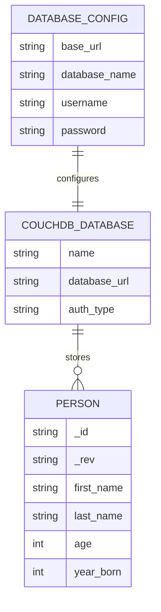

# NoSQL Application ERD

This project uses a document-oriented NoSQL design with Apache CouchDB. Instead of storing data in relational tables, each person is stored as a self-contained JSON document. The ERD below is a conceptual representation of the database model used by the app.

## Entity Relationship Diagram



## Entity Definitions

### 1. DatabaseConfig
Represents the connection settings entered by the user in the configuration screen.

Attributes:
- base_url: Base URL of the CouchDB server, for example `http://127.0.0.1:5984`
- database_name: The name of the target CouchDB database
- username: Database login username
- password: Database login password

Relationship:
- One DatabaseConfig is used to connect to one CouchDB database.

### 2. CouchDBDatabase
Represents the database instance used by the application.

Attributes:
- name: Database name, such as `nosql_db`
- database_url: Full URI of the database endpoint
- auth_type: Authentication method used for the server connection

Relationship:
- A CouchDB database contains zero or many Person documents.

### 3. Person
Represents each individual record stored in the database.

Attributes:
- _id: CouchDB-generated unique document ID
- _rev: CouchDB-generated revision ID for update/delete safety
- first_name: Person's first name
- last_name: Person's last name
- age: Person's age
- year_born: Year the person was born

Relationship:
- Each Person belongs to one CouchDB database.
- A Person is stored as a single JSON document, not a relational row.

## Conceptual Data Model

The application follows a simple document-based pattern:

- A user configures a database connection.
- The app connects to that database.
- Each person is stored as a document in the database.
- CRUD operations are performed on each document using CouchDB APIs.

Example document structure:

```json
{
  "_id": "unique-document-id",
  "_rev": "revision-id",
  "first_name": "John",
  "last_name": "Doe",
  "age": 28,
  "year_born": 1996
}
```

## Notes on the NoSQL Design

Unlike a relational ERD, this application does not model separate tables such as `persons`, `users`, or `database_settings`. Instead:

- `DatabaseConfig` is state used by the app, not a persisted relational table.
- `CouchDBDatabase` is the collection/namespace where documents are stored.
- `Person` is the main persisted entity represented as a JSON document.

This makes the system a good example of a document-oriented NoSQL database model used in a mobile Flutter application.
